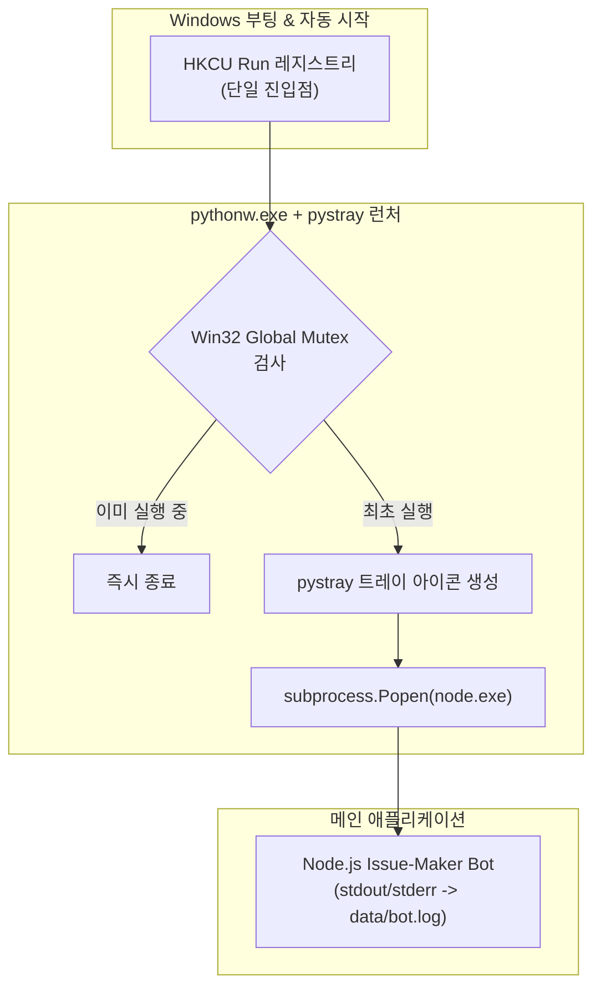

# Windows 백그라운드 트레이 런처 및 자동 시작 완벽 가이드
> **Issue-Maker 프로젝트 기술 전수 문서**  
> 작성일: 2026-11-09  
> 대상: 윈도우 환경에서 콘솔 창 없이 백그라운드 데몬 및 시스템 트레이(System Tray) 앱을 안정적으로 구축하고자 하는 엔지니어

---

## 📌 1. 아키텍처 개요 및 목표

Node.js, Python, Go 등으로 개발된 백그라운드 데몬(예: 텔레그램 봇, 로컬 AI 에이전트 등)을 일반 윈도우 사용자가 쓸 때 필수적인 요구사항은 다음과 같습니다:

1. **콘솔 창(검은색 CMD/PowerShell 창) 완전 은닉**: 백그라운드에서 완전히 조용히 동작해야 함.
2. **시스템 트레이 상주**: 작업 표시줄 시계 옆에 아이콘으로 상태를 표시하고, 우클릭 메뉴(로그 보기, .env 설정 열기, 재시작, 종료) 제공.
3. **PC 부팅 시 자동 시작**: 로그인 시 무인 실행.
4. **단일 인스턴스 보장(Single Instance)**: 재부팅, 중복 실행, 자동 시작 충돌 시에도 **오직 1개의 트레이와 1개의 봇만 실행**되어야 함 (중복 실행 시 텔레그램 `409 Conflict` 방지).



---

## ⚠️ 2. 시행착오 및 실패 원인 분석 (Post-Mortem)

본 시스템을 완성하기까지 겪었던 주요 실패 사례와 윈도우 OS 레벨의 원인은 다음과 같습니다.

### ❌ 시행착오 1: VBScript + PowerShell `-WindowStyle Hidden`
* **방식**: `wscript.exe`로 VBScript를 실행하고, VBScript가 `powershell.exe -WindowStyle Hidden`으로 백그라운드 실행.
* **실패 원인**:
  * 윈도우 로그인 직후 데스크톱 셸(`explorer.exe`)이 초기화되는 타이밍에, 백그라운드 숨김 모드로 실행된 PowerShell GUI 창을 윈도우 창 관리자가 "비정상/유령 프로세스"로 판단하여 **실행 중 강제 드랍(Drop/Kill)**시키는 현상 발생.
  * 결과적으로 재부팅 시 봇이 켜지지 않는 간헐적 장애 발생.

### ❌ 시행착오 2: PowerShell WinForms 기반 트레이
* **방식**: 별도 런타임 없이 `[System.Windows.Forms.NotifyIcon]`을 PowerShell 스크립트로 작성.
* **실패 원인**:
  1. **인코딩 문제**: PowerShell 콘솔의 코드페이지(CP949 vs UTF-8 BOM) 불일치로 인해 한글 메뉴명/이모지가 깨지거나 스크립트 구문 오류 발생.
  2. **이벤트 루프 제어 난이도**: `[Application]::Run()`과 백그라운드 프로세스 비동기 입출력 redirection이 충돌하여 멈춤 현상 발생.

### ❌ 시행착오 3: Windows Task Scheduler (작업 스케줄러)
* **방식**: `Register-ScheduledTask` 명령어로 로그인 시 트리거 등록.
* **실패 원인**:
  * 일반 사용자 권한(Non-Elevated) 세션에서는 UAC 보안 정책으로 인해 레지스트리 조작이 거부(`Access is denied`)됨.

### ❌ 시행착오 4: 시작프로그램 폴더 + Run 레지스트리 동시 등록으로 인한 '트레이 2개' 버그
* **방식**: 확실하게 띄우기 위해 `shell:startup` 바로가기(`.lnk`)와 `HKCU:\...\Run` 레지스트리를 둘 다 등록함.
* **실패 원인**:
  * 윈도우는 두 위치를 모두 읽어 각각 실행하므로 **트레이가 2개 뜸**.
  * 결과적으로 `node dist/index.js`도 2개 실행되어 텔레그램 `getUpdates` 롱폴링 충돌로 **`409 Conflict: terminated by other getUpdates request`** 발생하며 봇 서비스 다운.

---

## 🏆 3. 검증된 올바른 표준 아키텍처 (Best Practice)

### 핵심 1. 런처 엔진: `pythonw.exe` + `pystray`
* `python.exe`가 아닌 **`pythonw.exe`**를 사용합니다.
* `pythonw.exe`는 윈도우 OS가 인식하는 **공식 GUI 무음 실행 바이너리**이므로, 어떤 깜빡임이나 CMD 콘솔 창도 생성하지 않습니다.
* `pystray` 라이브러리는 Windows Native Shell_NotifyIcon API를 정확히 래핑하여 가장 안정적인 트레이 아이콘과 우클릭 메뉴를 제공합니다.

### 핵심 2. 커널 레벨 단일 인스턴스 보장 (Win32 Mutex)
프로세스 이름이나 포트 확인 방식은 레이스 컨디션(Race Condition)이 발생합니다. **Windows 커널 객체인 Mutex**를 생성하여 첫 번째 프로세스만 실행을 허용합니다:

```python
import ctypes
from ctypes import wintypes
import sys

ERROR_ALREADY_EXISTS = 183

def acquire_single_instance_mutex():
    kernel32 = ctypes.windll.kernel32
    CreateMutexW = kernel32.CreateMutexW
    CreateMutexW.argtypes = [wintypes.LPVOID, wintypes.BOOL, wintypes.LPCWSTR]
    CreateMutexW.restype = wintypes.HANDLE

    # Global\ 네임스페이스를 사용하여 세션 전체에서 고유 식별
    mutex_name = "Global\\IssueMakerBot_Pystray_SingleInstance_Mutex"
    mutex_handle = CreateMutexW(None, True, mutex_name)
    last_error = kernel32.GetLastError()
    
    if last_error == ERROR_ALREADY_EXISTS:
        # 이미 다른 인스턴스가 실행 중이면 0ms 만에 즉시 조용히 종료
        sys.exit(0)
```

### 핵심 3. 자동 시작 진입점의 단일화 (HKCU Run Registry)
* 시작프로그램 폴더(`.lnk`)를 병행하지 않고, **`HKCU:\Software\Microsoft\Windows\CurrentVersion\Run` 레지스트리 단 하나만** 등록합니다:
  * **Key**: `IssueMakerBot`
  * **Value**: `"C:\Software\issue-maker\.venv\Scripts\pythonw.exe" "C:\Software\issue-maker\scripts\tray_launcher.py"`
* 이렇게 하면:
  1. 재부팅 시 윈도우가 단 1회만 정확히 호출.
  2. 작업 관리자(Task Manager)의 **[시작 앱]** 탭에 올바르게 노출되어 사용자가 On/Off 토글 가능.

### 핵심 4. 하위 프로세스(Child Daemon) 생명주기 제어
트레이 런처가 메인 데몬(`node.exe`)을 띄우고 회수할 때 고아 프로세스(Zombie Process)가 남지 않도록 완벽히 제어합니다:

```python
# 시작 시
log_fp = open(LOG_FILE, "a", encoding="utf-8")
bot_process = subprocess.Popen(
    ["node", NODE_APP],
    cwd=PROJECT_DIR,
    stdout=log_fp,
    stderr=subprocess.STDOUT,
    creationflags=subprocess.CREATE_NO_WINDOW
)

# 종료 / 재시작 시
bot_process.terminate()
bot_process.wait(timeout=2)
# 잔여 node.exe 프로세스 강제 정리
```

---

## 🛠️ 4. 실전 코드 및 설정 파일 구성

* [scripts/tray_launcher.py](file:///c:/Software/issue-maker/scripts/tray_launcher.py): Win32 Mutex + pystray + 서브프로세스 관리 메인 트레이 코드
* [run_tray.bat](file:///c:/Software/issue-maker/run_tray.bat): 수동 실행용 무음 배치 스크립트
* [scripts/register-startup.ps1](file:///c:/Software/issue-maker/scripts/register-startup.ps1): HKCU Run 레지스트리 단일 등록 스크립트
* [scripts/unregister-startup.ps1](file:///c:/Software/issue-maker/scripts/unregister-startup.ps1): 자동 시작 해제 스크립트

---

## 📋 5. 요약 체크리스트 (다른 프로젝트 적용 시)

1. [ ] 백그라운드 런처는 VBScript나 PowerShell Hidden 대신 **`pythonw.exe`**를 사용할 것.
2. [ ] 트레이 스크립트 최상단에 **Win32 `CreateMutexW`** 단일 인스턴스 검사를 둘 것.
3. [ ] 윈도우 시작프로그램은 `shell:startup` 폴더와 `Run` 레지스트리 중 **`HKCU Run` 하나만** 사용할 것.
4. [ ] 데몬 표준 출력은 파일(`bot.log`)에 append 모드로 안전하게 기록할 것.
5. [ ] 트레이 우클릭 메뉴에 `로그 보기`, `재시작`, `종료`를 반드시 포함하여 사용자 통제권을 제공할 것.
